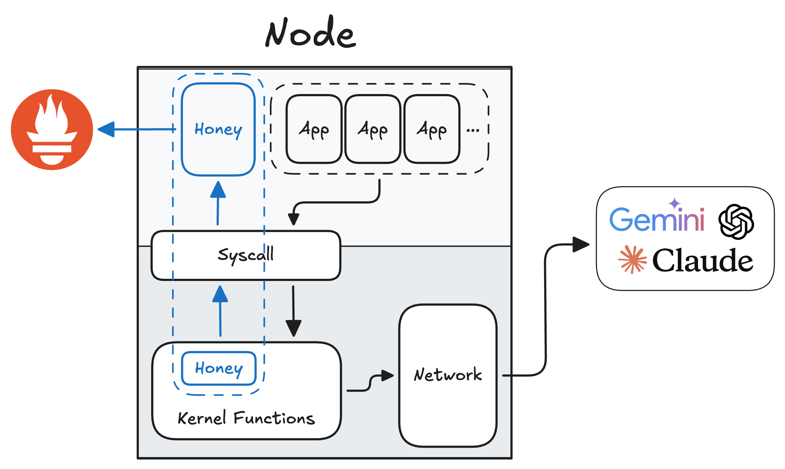
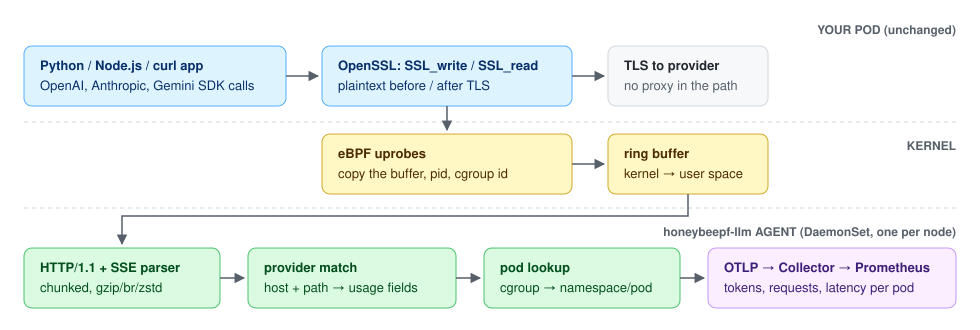
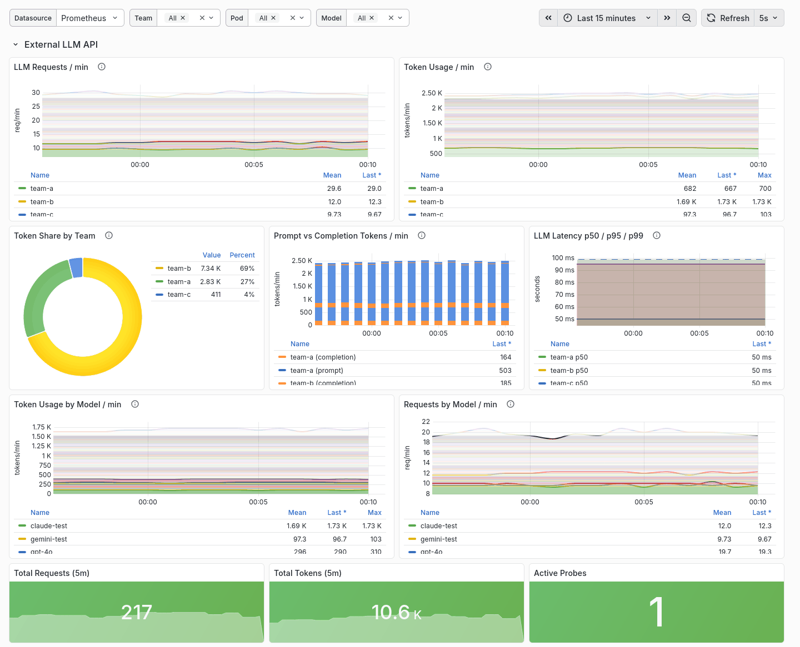
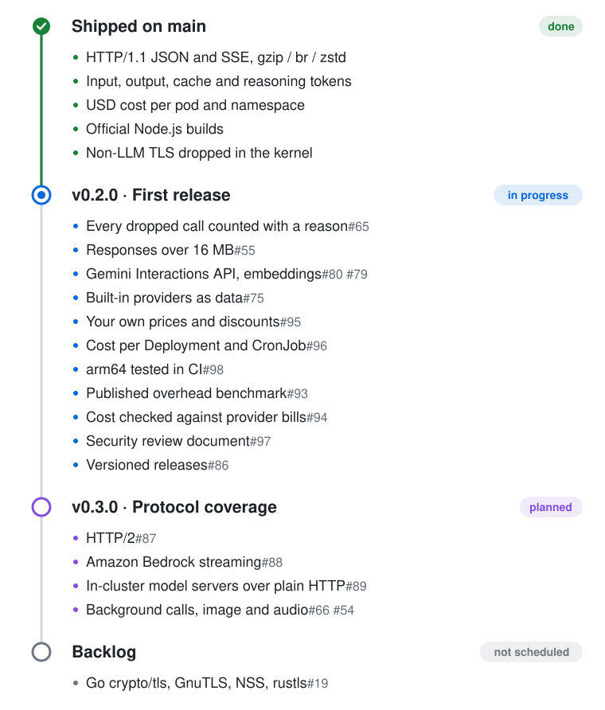

# honeybeepf-llm

**Per-pod LLM token, request and latency metrics from eBPF — no code changes, no proxy, no SDK.**

[](https://github.com/honeybee-studio/honeybeepf-llm/actions/workflows/docker-publish.yml)
[](https://github.com/honeybee-studio/honeybeepf-llm/actions/workflows/kernel-matrix.yml)
[](LICENSE)

honeybeepf-llm is a Rust eBPF agent that runs as a DaemonSet. It attaches uprobes to OpenSSL's `SSL_write` and
`SSL_read`, reads the plaintext HTTP of calls to LLM providers, and exports token usage, request counts and
latency per Kubernetes namespace and pod over OpenTelemetry.


<sub>Real output from a single-node k3s cluster with the charts from this repository and a locally built agent
image; the client pods call a local mock of the provider APIs with fake keys.</sub>

### Architecture



## Why

- **No code changes.** Applications keep their SDKs and their real provider hostnames. Nothing to import, wrap or
  redeploy.
- **No proxy.** Traffic goes straight from the pod to the provider; the agent only reads copies of the buffers
  that OpenSSL encrypts and decrypts. If the agent stops, requests carry on unaffected.
- **API keys stay out of logs and metrics.** The agent logs only the request path (without its query), pid,
  model and token counts, never headers or bodies. A test sends fake keys in headers, bodies and query strings
  and checks every log record at every level ([#45](https://github.com/honeybee-studio/honeybeepf-llm/pull/45)).
- **Per pod.** Calls from pods are labelled with `target_namespace` and `target_pod_name`, so cost can be split
  by team or workload without tagging requests.

## Quickstart

Requires a Kubernetes cluster whose nodes run a Linux 5.10+ or RHEL 8.10 / 9.6 / 9.7 kernel, `kubectl` and Helm 3.

```bash
git clone https://github.com/honeybee-studio/honeybeepf-llm.git
cd honeybeepf-llm
helm repo add prometheus-community https://prometheus-community.github.io/helm-charts
helm repo add open-telemetry https://open-telemetry.github.io/opentelemetry-helm-charts
helm dependency build charts/honeybeepf-llm-prometheus
helm dependency build charts/honeybeepf-llm-otel-collector

kubectl create namespace honeybeepf
helm install honeybeepf-llm-prometheus charts/honeybeepf-llm-prometheus -n honeybeepf
helm install honeybeepf-llm-otel-collector charts/honeybeepf-llm-otel-collector -n honeybeepf
helm install honeybeepf-llm charts/honeybeepf-llm -n honeybeepf \
  --set builtinProbes.llm.enabled=true \
  --set output.otlp.endpoint=honeybeepf-llm-otel-collector-opentelemetry-collector:4317
```

Watch LLM calls as they happen:

```bash
kubectl logs -n honeybeepf ds/honeybeepf-llm -f | grep 'LLM SUCCESS'
```

`ds/honeybeepf-llm` follows one agent pod; on a cluster with several nodes, each node's calls are in that node's
agent pod.

```
2026-10-26T08:43:35.510264Z  INFO honeybeepf_llm::probes::builtin::llm::processor: LLM SUCCESS | PID: 1686847 | Model: claude-test | Latency: 0.00s | Tokens: 140 (Prompt: 125, Compl: 15, Cache read: 100, Cache write: 0) | Pod: team-b/support-bot-589db898dd-rv9ts
```

The agent needs `hostPID` and the `BPF`, `PERFMON`, `SYS_ADMIN` and `SYS_PTRACE` capabilities, and requests 200m CPU / 512Mi per node (limits 1 CPU / 1Gi); see
[`values.yaml`](charts/honeybeepf-llm/values.yaml).

Uninstall:

```bash
helm uninstall honeybeepf-llm honeybeepf-llm-otel-collector honeybeepf-llm-prometheus -n honeybeepf
kubectl delete namespace honeybeepf
```

## What is supported

✅ means the agent recorded exactly the expected token counts on Linux 7.0, against a local TLS mock of each
provider's API called by curl and by the official Python and Node.js SDKs; recorded real provider responses are
replayed against it as well. A blank cell was not checked.

**Providers** (built in, no configuration)

| Provider / API | JSON | Streaming (SSE) | Cache tokens |
|---|:-:|:-:|:-:|
| OpenAI Chat Completions | ✅ | ✅ | ✅ read |
| OpenAI Responses API | ✅ | ✅ | |
| Anthropic Messages | ✅ | ✅ | ✅ read/write |
| Google Gemini (`generateContent`, `streamGenerateContent`) | ✅ | ✅ | ✅ read |
| Azure OpenAI | ✅ Chat Completions | ✅ Responses API | |
| Google Vertex AI (Gemini) | ✅ | ✅ | |
| Claude on Vertex AI, Google Cloud and Microsoft Foundry | ✅ | ✅ | ✅ read/write |
| Amazon Bedrock Converse | ✅ | ❌ event-stream responses | ✅ read/write |
| Amazon Bedrock InvokeModel (Anthropic Claude models) | ✅ | ❌ event-stream responses | ✅ read/write |

Compressed responses (`gzip`, `br`, `zstd`, `deflate`) are decoded, SSE included.

`builtinProbes.llm.providers` in `values.yaml` describes providers by host, path and usage fields, in the format of
the [built-in list](honeybeepf-llm/honeybeepf-llm-core/src/providers/default_providers.json). They are added to the
built-in providers; a provider with a built-in name (`openai`, `anthropic`, `gemini`, `bedrock`, matched exactly)
replaces every built-in entry of that name, so an `openai` entry must also cover the Responses API and an
`anthropic` entry Claude on Vertex AI. Usage is read by matching the response's fields, not its host, with the
built-in entries tried first: a gateway that returns an OpenAI-, Anthropic- or Gemini-shaped body is read with the
built-in fields. Only HTTPS calls made through OpenSSL are seen; a plain-HTTP endpoint (a typical in-cluster
Ollama or vLLM) is not.

**Runtimes** (also checked in pods on k3s: `python:3.12-slim`, `python:3.13-alpine`, `node:24-slim`)

| Runtime | TLS library | Status |
|---|---|:-:|
| Python (CPython: `python:*-slim`, Alpine, distro) | shared `libssl` | ✅ |
| Node.js official binaries and `node:` images | OpenSSL inside the `node` executable | ✅ |
| Node.js from distro packages | shared `libssl` | ✅ |
| curl and other programs linked to `libssl` | shared `libssl` | ✅ |
| Go (`crypto/tls`), rustls, Java (JSSE), GnuTLS, NSS | not OpenSSL | ❌ not seen |

**Protocols**

| Protocol | Status |
|---|:-:|
| HTTP/1.1 (keep-alive, chunked) | ✅ |
| HTTP/2 | ❌ not parsed yet |
| WebSocket (e.g. OpenAI Realtime) | ❌ |
| HTTP/3 (QUIC) | ❌ |

Node.js 26 negotiates HTTP/2 by default: its built-in `fetch` (undici 8) picks HTTP/2 whenever the server offers
it, and the official OpenAI and Anthropic Node SDKs call that `fetch`, so their calls are not recorded yet
([#87](https://github.com/honeybee-studio/honeybeepf-llm/issues/87)). Node.js 24 (undici 7) uses HTTP/1.1 and is
recorded. Either of these switches the calls back to HTTP/1.1; both were checked with Node.js 26.13.0,
`undici` 8.12.2, `openai` 7.39.0 and `@anthropic-ai/sdk` 0.135.0, JSON and streaming:

- Without changing the application: add the `undici` package and preload a file that replaces the global
  dispatcher, for example with `NODE_OPTIONS="--import ./force-h1.mjs"`:

  ```js
  // force-h1.mjs
  import { Agent, setGlobalDispatcher } from 'undici';
  setGlobalDispatcher(new Agent({ allowH2: false }));
  ```

- Per client: pass the dispatcher to the SDK client or to `fetch`:

  ```js
  import { Agent } from 'undici';
  const dispatcher = new Agent({ allowH2: false });
  const openai = new OpenAI({ fetchOptions: { dispatcher } });
  const anthropic = new Anthropic({ fetchOptions: { dispatcher } });
  const res = await fetch(url, { dispatcher });
  ```

**Kernels:** CI loads and attaches the probes and detects an LLM request on 5.10, 5.15, 6.1, 6.6, 6.12, 6.18
and 7.2, and on the RHEL 8.10 (4.18), 9.6 and 9.7 (5.14) kernels
([kernel matrix](.github/workflows/kernel-matrix.yml)); other RHEL minor releases are not tested. Token counts
are checked on Linux 7.0 (the tables above).

**Overhead:** CPU, memory, latency and accuracy under load are measured in [docs/benchmark.md](docs/benchmark.md).

## How it works



1. The agent finds every `libssl` mapped by a process (and executables with OpenSSL built in) and attaches
   uprobes to `SSL_write` and `SSL_read`, including libraries opened after it started.
2. The uprobes copy the plaintext buffer, the pid and the cgroup id into a BPF ring buffer.
3. In user space, the HTTP/1.1 and SSE parser reassembles each request and response per TLS connection, picks
   the provider from the host and path, and reads the usage fields from the response.
4. The process's cgroup gives its container ID, which a watch on this node's pods maps to a namespace and pod.
   The result is recorded as OpenTelemetry metrics sent over OTLP to the collector, which Prometheus scrapes.

## Metrics

| Metric (as stored by the bundled Prometheus) | Type | Labels |
|---|---|---|
| `honeybeepf_llm_llm_requests_total` | counter | `model`, `status`, `target_namespace`, `target_pod_name`, `target_workload_kind`, `target_workload_name` |
| `honeybeepf_llm_llm_tokens_total` | counter | same, plus `token_type` (`prompt` / `completion`) |
| `honeybeepf_llm_llm_cache_read_tokens_total` | counter | same as requests (subset of prompt tokens) |
| `honeybeepf_llm_llm_cache_write_tokens_total` | counter | same as requests (subset of prompt tokens) |
| `honeybeepf_llm_llm_reasoning_tokens_total` | counter | same as requests (subset of completion tokens) |
| `honeybeepf_llm_llm_latency_seconds` | histogram | same as requests |
| `honeybeepf_llm_llm_responses_unparsed_total` | counter | `reason`, `target_namespace`, `target_pod_name`, `target_workload_kind`, `target_workload_name` |

`llm_responses_unparsed_total` counts LLM calls the agent saw but could not record, so a drop in recorded calls
can be told apart from a drop in traffic. `reason` is one of:

| `reason` | The call was given up because |
|---|---|
| `capture_lost` | part of a response read was lost in capture (ring buffer full after its first 4 KB, or one read over 16 KB) |
| `next_request` | a complete HTTP/1.1 response had no usage when the next request started |
| `connection_closed` | the connection closed before usage was found |
| `request_too_large` | the captured request bytes (the first 4 KB of each write) passed the 8 MB buffer limit |
| `response_too_large` | the response passed the 16 MB buffer limit and is neither an uncompressed HTTP/1.1 JSON body with usage in its first or last 64 KB nor an uncompressed HTTP/1.1 SSE stream (compressed and HTTP/2 responses always count here) |

Not counted here: a read lost whole because the ring buffer was full (see `llm_events_total{stage="reserve_fail"}`),
and a connection left idle for 300 s without being closed (for example a killed process).

Unparsed calls per minute by reason, for an alert on `> 0`:

```promql
sum by (target_namespace, reason) (rate(honeybeepf_llm_llm_responses_unparsed_total[5m])) * 60
```

The collector and Prometheus add more labels, such as `k8s_pod_name`, `k8s_node_name` and `namespace`; those name
the agent's pod and node and the collector's namespace. `target_namespace` and `target_pod_name` name the pod
that made the call. `target_workload_kind` and `target_workload_name` name its owner: a Deployment or an Argo
Rollout (through its ReplicaSet), a CronJob (through its Job, which needs the chart's `jobs get` permission), a
StatefulSet or DaemonSet, or `Pod` and the pod name for a pod without an owner; `unattributed` if the owner cannot
be named.

To compare variants of one workload (an A/B test, two versions), list pod labels in `builtinProbes.llm.podLabels`.
Each becomes `target_pod_label_<name>` on every LLM metric, with characters other than letters, digits and `_`
replaced by `_` (`app.kubernetes.io/version` → `target_pod_label_app_kubernetes_io_version`). A pod without the
label gets none. Each label multiplies the series by its distinct values, so the list is empty by default.

The Quickstart's Prometheus is the `honeybeepf-llm-prometheus-server` service (port 80) in the `honeybeepf`
namespace. Tokens per minute by namespace:

```promql
sum by (target_namespace, token_type) (rate(honeybeepf_llm_llm_tokens_total[5m])) * 60
```

On the demo cluster above:

```
{target_namespace="team-a", token_type="prompt"}       371
{target_namespace="team-a", token_type="completion"}   121
{target_namespace="team-b", token_type="prompt"}      1021
{target_namespace="team-b", token_type="completion"}   123
{target_namespace="team-c", token_type="prompt"}        50
{target_namespace="team-c", token_type="completion"}    21
```

### Grafana

Two dashboards ship in [`docs/grafana/`](docs/grafana/): **LLM Cost Observability**
([`honeybeepf-cost.json`](docs/grafana/honeybeepf-cost.json)) and **Security & Compliance**
([`honeybeepf-security.json`](docs/grafana/honeybeepf-security.json)); the security dashboard needs the file-access
probe, which is off by default (`builtinProbes.filesystem.file_access.enabled`). Import them in Grafana
(**Dashboards → New → Import**), or let the Grafana sidecar load them:

```bash
kubectl -n monitoring create configmap honeybeepf-dashboards \
  --from-file=docs/grafana/honeybeepf-cost.json \
  --from-file=docs/grafana/honeybeepf-security.json
kubectl -n monitoring label configmap honeybeepf-dashboards grafana_dashboard=1
```



See [`docs/grafana/README.md`](docs/grafana/README.md) for the template variables and other options.

## Building from source

Requires the nightly toolchain with `rust-src` and `bpf-linker`; see the
[prerequisites](honeybeepf-llm/docs/BINARY_DEPLOYMENT.md#-prerequisites).

```bash
cd honeybeepf-llm
cargo +nightly build --release --package honeybeepf-llm --features k8s
```

The `k8s` feature adds the pod labels and is not enabled by default; the Docker image is built with it. Without
Kubernetes, see [running the binary](honeybeepf-llm/docs/BINARY_DEPLOYMENT.md).

## Roadmap



Each section is a milestone: [v0.2.0](https://github.com/honeybee-studio/honeybeepf-llm/milestone/1) · [v0.3.0](https://github.com/honeybee-studio/honeybeepf-llm/milestone/2) · [Backlog](https://github.com/honeybee-studio/honeybeepf-llm/milestone/3). The milestones have no dates yet;
open them for the current progress.

## Contributing

Bug reports and feature requests go to [GitHub Issues](https://github.com/honeybee-studio/honeybeepf-llm/issues).
Read [`CONTRIBUTING.md`](CONTRIBUTING.md) before opening a pull request; it covers coding standards, review
expectations and the AI tooling policy.

## Team

| Name | Role | Responsibilities |
|------|------|------------------|
| Jundorok | Team Leader | Roadmap & Feature Development |
| pmj-chosim | Core Dev | CI/CD & Observability |
| sammiee5311 | Core Dev | Feature Development |
| vanillaturtlechips | Core Dev | CI/CD & Observability |

## Governance & community

- **Code of Conduct:** see [`CODE_OF_CONDUCT.md`](CODE_OF_CONDUCT.md). Report incidents privately via
  [GitHub Issues](https://github.com/honeybee-studio/honeybeepf-llm/issues).
- **Decisions:** maintainers document proposals in Issues/Discussions with a 72-hour community review window
  before landing major changes; see [`GOVERNANCE.md`](GOVERNANCE.md).
- **Meetings:** quarterly community syncs are announced in GitHub Discussions, with notes published alongside
  meeting issues.
- **Membership:** active contributors who review and merge work over two consecutive releases are invited to
  join the maintainer group.

## License

Source code and documentation are licensed under the [Apache License 2.0](LICENSE); see also [`NOTICE`](NOTICE).
Third-party assets carry their own notices in their directories.
