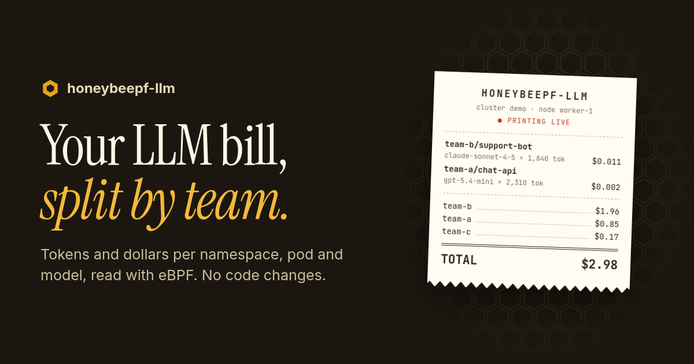

# honeybeepf-llm

**See what every Kubernetes team spends on LLMs — tokens and estimated USD per namespace, pod and model, straight from eBPF. No code changes, no proxy, no SDK.**

[](https://github.com/honeybee-studio/honeybeepf-llm/actions/workflows/docker-publish.yml)
[](https://github.com/honeybee-studio/honeybeepf-llm/actions/workflows/kernel-matrix.yml)
[](LICENSE)
[](https://artifacthub.io/packages/search?repo=honeybeepf-llm)
[](https://scorecard.dev/viewer/?uri=github.com/honeybee-studio/honeybeepf-llm)
[](https://honeybee-studio.github.io/honeybeepf-llm/)

**[Documentation](https://honeybee-studio.github.io/honeybeepf-llm/)** · [Quickstart](https://honeybee-studio.github.io/honeybeepf-llm/quickstart/) · [How it works](https://honeybee-studio.github.io/honeybeepf-llm/how-it-works/) ·
[What is supported](https://honeybee-studio.github.io/honeybeepf-llm/providers/) · [FAQ](https://honeybee-studio.github.io/honeybeepf-llm/faq/)



- **No app code changed.** SDKs keep calling the real provider; nothing to import, wrap or redeploy.
- **Off the request path.** ~55 µs of agent CPU per LLM call at 200 calls/s, 32 MB RSS plus 19 MB of BPF maps, and
  −6.6% throughput at ~11k calls/s, measured with and without the agent in v0.3.2
  ([benchmark](https://honeybee-studio.github.io/honeybeepf-llm/benchmark/)).
- **The major providers built in:** OpenAI, Anthropic, Gemini, Amazon Bedrock, Azure OpenAI, Google Vertex AI and Meta,
  plus many OpenAI-compatible APIs such as Groq, DeepSeek, Mistral, Together and OpenRouter
  ([full list](https://honeybee-studio.github.io/honeybeepf-llm/providers/)).
- **Checked in CI** on Linux 5.10 to 7.2 and RHEL 8.10 / 9.6 / 9.7, x86-64 and arm64: probes loaded and attached,
  and token counts checked on each.

honeybeepf-llm is a Rust eBPF agent that runs as a DaemonSet. It attaches uprobes to OpenSSL's `SSL_write` and
`SSL_read` and to Go's `crypto/tls`, reads the plaintext HTTP of calls to LLM providers, and exports token usage,
request counts, latency and estimated cost per Kubernetes namespace and pod over OpenTelemetry.

## Quickstart

Requires a cluster whose nodes run a Linux 5.10+ or RHEL 8.10 / 9.6 / 9.7 kernel, `kubectl` and Helm 3:

```bash
kubectl create namespace honeybeepf
helm install honeybeepf-llm oci://ghcr.io/honeybee-studio/charts/honeybeepf-llm --version 0.4.0 -n honeybeepf
kubectl logs -n honeybeepf ds/honeybeepf-llm -f | grep 'LLM SUCCESS'
```


- No LLM traffic yet? [Try the demo](https://honeybee-studio.github.io/honeybeepf-llm/demo/): a mock provider, clients in three team namespaces and Grafana, with
  no API keys.
- For the Grafana cost dashboard, [install](https://honeybee-studio.github.io/honeybeepf-llm/install/) the bundled Prometheus and OpenTelemetry Collector too.
- The chart in `charts/` on `main` can expect a newer agent than the latest release image, so install it only
  together with an image built from the same commit.

## How it compares

| | Gateway / proxy | SDK instrumentation | honeybeepf-llm (eBPF) |
|---|---|---|---|
| App change | new base URL | add code, redeploy | none |
| In the request path | yes | in-process | no — reads buffer copies |
| Calls it sees | only those routed through it | only instrumented code | every pod on the node |
| API keys | pass through it | in the app process | never logged (path, model, tokens only) |

## What it sees

| | Seen | Not yet |
|---|---|---|
| Apps | Python, Node.js, curl and anything using OpenSSL; Go 1.20+ | rustls, Java (JSSE), GnuTLS, NSS, Go before 1.20 |
| Protocols | HTTP/1.1 and HTTP/2, streaming included; OpenAI Realtime and Responses over a WebSocket; in-cluster plain HTTP (Ollama, vLLM), opt-in | Other WebSocket APIs, HTTP/3 |
| Calls | chat, embeddings, image and transcription, with cache and reasoning tokens | |

Cost comes from a built-in price table matched by the model name; models without a price are counted as unpriced
tokens, not as $0, until you [add their prices](https://honeybee-studio.github.io/honeybeepf-llm/guides/prices/). One query
[lists the workloads whose calls are not seen](https://honeybee-studio.github.io/honeybeepf-llm/guides/coverage/). The per-provider matrix is in
[What is supported](https://honeybee-studio.github.io/honeybeepf-llm/providers/).

## How it works


The agent attaches to the TLS functions of every process on its node, copies the plaintext of each call into a ring
buffer, reads the usage fields from the response, maps the process to its pod and exports the result as OpenTelemetry
metrics. [How it works](https://honeybee-studio.github.io/honeybeepf-llm/how-it-works/) goes step by step; the [security review](https://honeybee-studio.github.io/honeybeepf-llm/security-review/) lists every
hook, privilege and what the agent can and cannot see.

## Documentation

The docs are at **[honeybee-studio.github.io/honeybeepf-llm](https://honeybee-studio.github.io/honeybeepf-llm/)**, built from [`docs/`](docs/).

| | |
|---|---|
| Get started | [Quickstart](https://honeybee-studio.github.io/honeybeepf-llm/quickstart/) · [Try the demo](https://honeybee-studio.github.io/honeybeepf-llm/demo/) · [Install](https://honeybee-studio.github.io/honeybeepf-llm/install/) · [Verify the image, chart and binaries](https://honeybee-studio.github.io/honeybeepf-llm/verify/) · [Build from source](https://honeybee-studio.github.io/honeybeepf-llm/build/) · [Run without Kubernetes](https://honeybee-studio.github.io/honeybeepf-llm/run-binary/) |
| Concepts | [How it works](https://honeybee-studio.github.io/honeybeepf-llm/how-it-works/) · [What is supported](https://honeybee-studio.github.io/honeybeepf-llm/providers/) · [Cost and prices](https://honeybee-studio.github.io/honeybeepf-llm/cost/) |
| Guides | [Workloads not seen](https://honeybee-studio.github.io/honeybeepf-llm/guides/coverage/) · [Add a provider](https://honeybee-studio.github.io/honeybeepf-llm/guides/custom-providers/) · [Add your own prices](https://honeybee-studio.github.io/honeybeepf-llm/guides/prices/) · [Plain-HTTP model servers](https://honeybee-studio.github.io/honeybeepf-llm/guides/plaintext/) · [Budgets and alerts](https://honeybee-studio.github.io/honeybeepf-llm/alerts/) · [Grafana dashboards](https://honeybee-studio.github.io/honeybeepf-llm/grafana/) |
| Reference | [Metrics](https://honeybee-studio.github.io/honeybeepf-llm/metrics/) · [Helm values](https://honeybee-studio.github.io/honeybeepf-llm/reference-values/) |
| Operations | [Overhead benchmark](https://honeybee-studio.github.io/honeybeepf-llm/benchmark/) · [Security review](https://honeybee-studio.github.io/honeybeepf-llm/security-review/) · [Troubleshooting](https://honeybee-studio.github.io/honeybeepf-llm/troubleshooting/) · [FAQ](https://honeybee-studio.github.io/honeybeepf-llm/faq/) |

## Roadmap

Each release is a [milestone](https://github.com/honeybee-studio/honeybeepf-llm/milestones) with its issues and
progress: the open ones show what comes next, and
[Backlog](https://github.com/honeybee-studio/honeybeepf-llm/milestone/3) holds what is not scheduled yet.

## Contributing

Bug reports and feature requests go to [GitHub Issues](https://github.com/honeybee-studio/honeybeepf-llm/issues).
Read [`CONTRIBUTING.md`](CONTRIBUTING.md) before opening a pull request; it covers coding standards, review
expectations and the AI tooling policy.

## Governance & community

- **Code of Conduct:** see [`CODE_OF_CONDUCT.md`](CODE_OF_CONDUCT.md). Report incidents privately via
  [GitHub Issues](https://github.com/honeybee-studio/honeybeepf-llm/issues).
- **Decisions:** maintainers document proposals in Issues/Discussions with a 72-hour community review window
  before landing major changes; see [`GOVERNANCE.md`](GOVERNANCE.md).
- **Meetings:** quarterly community syncs are announced in GitHub Discussions, with notes published alongside
  meeting issues.
- **Membership:** active contributors who review and merge work over two consecutive releases are invited to
  join the maintainer group.

## License

Source code and documentation are licensed under the [Apache License 2.0](LICENSE); see also [`NOTICE`](NOTICE).
Third-party assets carry their own notices in their directories.
