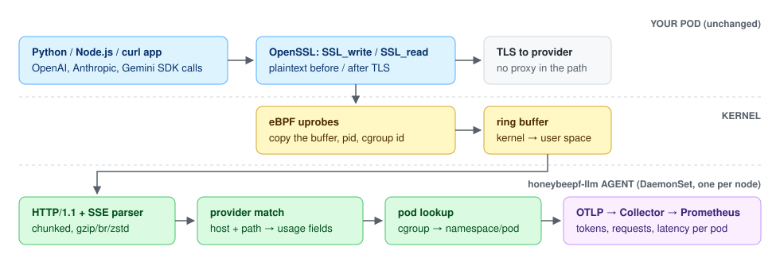
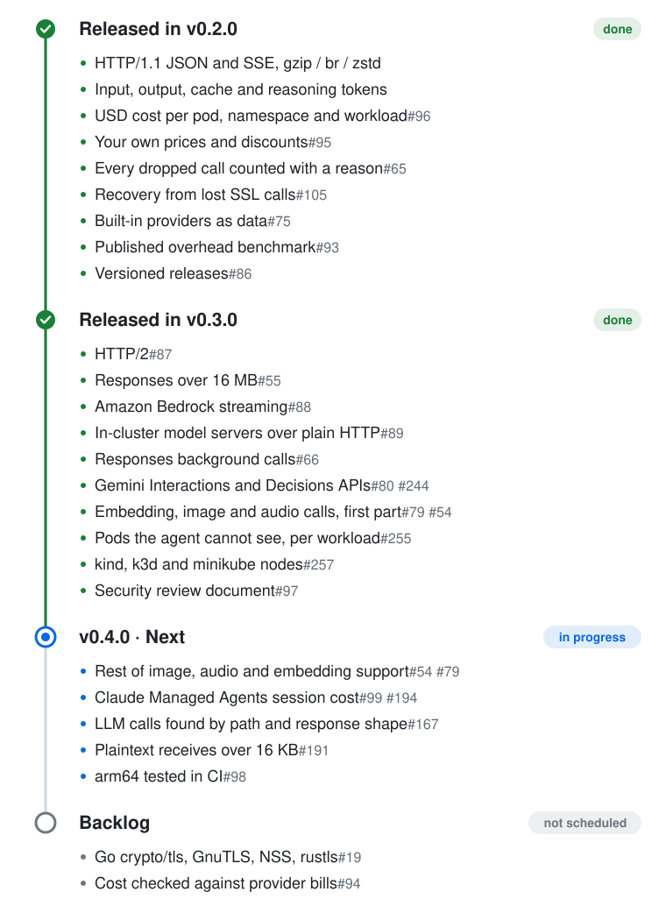

# honeybeepf-llm

**See what every Kubernetes team spends on LLMs — tokens and estimated USD per namespace, pod and model, straight from eBPF. No code changes, no proxy, no SDK.**

[](https://github.com/honeybee-studio/honeybeepf-llm/actions/workflows/docker-publish.yml)
[](https://github.com/honeybee-studio/honeybeepf-llm/actions/workflows/kernel-matrix.yml)
[](LICENSE)


<sub>The bundled LLM Cost Observability dashboard on a single-node k3s cluster, built from the charts in this
repository against a local mock of the provider APIs with fake keys.</sub>

- **0 lines of app code changed** — SDKs keep calling the real provider; nothing to import, wrap or redeploy.
- **~7.7 µs of agent CPU per request** at ~31 MB RSS, measured A/B at ~6.8k HTTPS requests/s ([benchmark](docs/benchmark.md)).
- **11 built-in provider APIs** — OpenAI, Anthropic, Gemini, Amazon Bedrock, Azure OpenAI, Google Vertex AI, Meta.
- **10 kernels in CI** — Linux 5.10 through 7.2 and RHEL 8.10 / 9.6 / 9.7, probes loaded and attached on x86-64 (and arm64 on 5.15 and 6.1).

honeybeepf-llm is a Rust eBPF agent that runs as a DaemonSet. It attaches uprobes to OpenSSL's `SSL_write` and
`SSL_read`, reads the plaintext HTTP of calls to LLM providers, and exports token usage, request counts and
latency per Kubernetes namespace and pod over OpenTelemetry.

## Quickstart

Requires a cluster whose nodes run a Linux 5.10+ or RHEL 8.10 / 9.6 / 9.7 kernel, `kubectl` and Helm 3. Install the
agent and watch LLM calls per pod:

```bash
git clone https://github.com/honeybee-studio/honeybeepf-llm.git
cd honeybeepf-llm
kubectl create namespace honeybeepf
helm install honeybeepf-llm charts/honeybeepf-llm -n honeybeepf \
  --set builtinProbes.llm.enabled=true
kubectl logs -n honeybeepf ds/honeybeepf-llm -f | grep 'LLM SUCCESS'
```


```
LLM SUCCESS | PID: 1686847 | Model: claude-test | Latency: 0.00s | Tokens: 140 (Prompt: 125, Compl: 15, Cache read: 100, Cache write: 0) | Pod: team-b/support-bot-589db898dd-rv9ts
```

For the Grafana cost dashboard, install the bundled Prometheus and OpenTelemetry Collector charts too. Full
commands, required capabilities, resources and uninstall are in [docs/install.md](docs/install.md).

## How it compares

| | Gateway / proxy | SDK instrumentation | honeybeepf-llm (eBPF) |
|---|---|---|---|
| App change | new base URL | add code, redeploy | none |
| In the request path | yes | in-process | no — reads buffer copies |
| Calls it sees | only those routed through it | only instrumented code | every pod on the node |
| API keys | pass through it | in the app process | never logged (path, model, tokens only) |

## What is supported

| Dimension | Covered |
|---|---|
| Providers | 11 built-in APIs: OpenAI, Anthropic, Gemini, Amazon Bedrock, Azure OpenAI, Google Vertex AI, Meta — JSON, streaming (SSE), cache tokens |
| Runtimes | Python, Node.js, curl, anything linked to OpenSSL `libssl` — not Go `crypto/tls`, rustls, JSSE, GnuTLS, NSS |
| Protocols | HTTP/1.1 and HTTP/2 — not WebSocket, not HTTP/3 (QUIC) |
| Transport | HTTPS through OpenSSL; in-cluster plain HTTP (Ollama, vLLM) on opt-in |
| Kernels | Linux 5.10–7.2 and RHEL 8.10 / 9.6 / 9.7 on x86-64, 5.15 and 6.1 on arm64, loaded and attached in CI; token counts checked on 7.0 |

The exact checks, how to add a provider, and plain-HTTP capture are in [docs/providers.md](docs/providers.md).

## How it works



1. The agent finds every `libssl` mapped by a process (and executables with OpenSSL built in) and attaches
   uprobes to `SSL_write` and `SSL_read`, including libraries opened after it started.
2. The uprobes copy the plaintext buffer, the pid and the cgroup id into a BPF ring buffer.
3. In user space, the HTTP/1.1, HTTP/2 and SSE parser reassembles each request and response per TLS connection, picks
   the provider from the host and path, and reads the usage fields from the response.
4. The process's cgroup gives its container ID, which a watch on this node's pods maps to a namespace and pod.
   The result is recorded as OpenTelemetry metrics sent over OTLP to the collector, which Prometheus scrapes.

## Metrics

Exported per namespace, pod and workload over OTLP, scraped by Prometheus:

- `llm_requests_total`, `llm_tokens_total` (prompt / completion) and `llm_latency_seconds`
- `llm_cache_read_tokens_total`, `llm_cache_write_tokens_total`, `llm_reasoning_tokens_total`
- `llm_cost_usd_total` — estimated USD per call from the built-in price table; `llm_unpriced_tokens_total` for tokens without a price
- `llm_responses_unparsed_total` — calls seen but not recorded, by `reason`

The bundled LLM Cost Grafana dashboard shows the cost per workload and per model. Labels, unparsed reasons and example PromQL are in [docs/metrics.md](docs/metrics.md);
the dashboards ship in [docs/grafana/](docs/grafana/).

## Documentation

- [Install and build from source](docs/install.md)
- [Security review](docs/security-review.md)
- [Supported providers, runtimes, protocols and kernels](docs/providers.md)
- [Metrics reference](docs/metrics.md)
- [Overhead benchmark](docs/benchmark.md)
- [Grafana dashboards](docs/grafana/)

## Roadmap



Each section is a milestone: [v0.2.0](https://github.com/honeybee-studio/honeybeepf-llm/milestone/1) · [v0.3.0](https://github.com/honeybee-studio/honeybeepf-llm/milestone/2) · [Backlog](https://github.com/honeybee-studio/honeybeepf-llm/milestone/3). The milestones have no dates yet;
open them for the current progress.

## Contributing

Bug reports and feature requests go to [GitHub Issues](https://github.com/honeybee-studio/honeybeepf-llm/issues).
Read [`CONTRIBUTING.md`](CONTRIBUTING.md) before opening a pull request; it covers coding standards, review
expectations and the AI tooling policy.

## Governance & community

- **Code of Conduct:** see [`CODE_OF_CONDUCT.md`](CODE_OF_CONDUCT.md). Report incidents privately via
  [GitHub Issues](https://github.com/honeybee-studio/honeybeepf-llm/issues).
- **Decisions:** maintainers document proposals in Issues/Discussions with a 72-hour community review window
  before landing major changes; see [`GOVERNANCE.md`](GOVERNANCE.md).
- **Meetings:** quarterly community syncs are announced in GitHub Discussions, with notes published alongside
  meeting issues.
- **Membership:** active contributors who review and merge work over two consecutive releases are invited to
  join the maintainer group.

## License

Source code and documentation are licensed under the [Apache License 2.0](LICENSE); see also [`NOTICE`](NOTICE).
Third-party assets carry their own notices in their directories.
