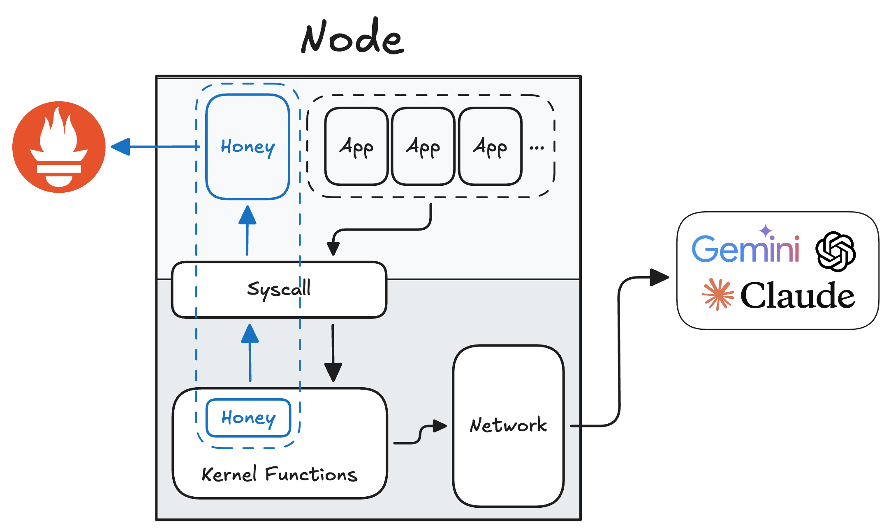

# honeybeepf-llm

**Per-pod LLM token, request and latency metrics from eBPF — no code changes, no proxy, no SDK.**

honeybeepf-llm is a Rust eBPF agent that runs as a DaemonSet. It attaches uprobes to OpenSSL's `SSL_write` and
`SSL_read`, reads the plaintext HTTP of calls to LLM providers, and exports token usage, request counts and
latency per Kubernetes namespace and pod over OpenTelemetry.

Real output from a single-node k3s cluster with the charts from this repository and a locally built agent
image; the client pods call a local mock of the provider APIs with fake keys.

### Architecture

## Why

- **No code changes.** Applications keep their SDKs and their real provider hostnames. Nothing to import, wrap or
  redeploy.
- **No proxy.** Traffic goes straight from the pod to the provider; the agent only reads copies of the buffers
  that OpenSSL encrypts and decrypts. If the agent stops, requests carry on unaffected.
- **API keys stay out of logs and metrics.** The agent logs only the request path (without its query), pid,
  model and token counts, never headers or bodies. A test sends fake keys in headers, bodies and query strings
  and checks every log record at every level ([#45](https://github.com/honeybee-studio/honeybeepf-llm/pull/45)).
- **Per pod.** Calls from pods are labelled with `target_namespace` and `target_pod_name`, so cost can be split
  by team or workload without tagging requests.
- **Negligible overhead.** In an A/B run on a 4-vCPU kernel-7.0 VM, the agent used about 0.01 s of CPU over 60 s
  idle, and about 7.7 microseconds of CPU per request (about 5% of one core) under ~6.8k HTTPS requests/s, at ~31 MB RSS
  (measured in #163).

## Quickstart

Install with Helm on a Kubernetes cluster and watch LLM calls per pod. The full commands, required capabilities
and resources, uninstall, and building from source are in [docs/install.md](docs/install.md).

## What is supported

The providers, runtimes, protocols and kernels the agent is checked against, how to add a provider, and capturing
a plain-HTTP endpoint (Ollama, vLLM) are in [docs/providers.md](docs/providers.md).

## How it works

1. The agent finds every `libssl` mapped by a process (and executables with OpenSSL built in) and attaches
   uprobes to `SSL_write` and `SSL_read`, including libraries opened after it started.
2. The uprobes copy the plaintext buffer, the pid and the cgroup id into a BPF ring buffer.
3. In user space, the HTTP/1.1, HTTP/2 and SSE parser reassembles each request and response per TLS connection, picks
   the provider from the host and path, and reads the usage fields from the response.
4. The process's cgroup gives its container ID, which a watch on this node's pods maps to a namespace and pod.
   The result is recorded as OpenTelemetry metrics sent over OTLP to the collector, which Prometheus scrapes.

## Metrics

The exported metrics and their labels, the `transport` label, the unparsed-reason counters with example alert
PromQL, and the `podLabels` option are in [docs/metrics.md](docs/metrics.md). Two Grafana dashboards — LLM Cost
Observability and Security & Compliance — ship in [docs/grafana/](docs/grafana/).

## Roadmap

Each section is a milestone: [v0.2.0](https://github.com/honeybee-studio/honeybeepf-llm/milestone/1) · [v0.3.0](https://github.com/honeybee-studio/honeybeepf-llm/milestone/2) · [Backlog](https://github.com/honeybee-studio/honeybeepf-llm/milestone/3). The milestones have no dates yet;
open them for the current progress.

## Contributing

Bug reports and feature requests go to [GitHub Issues](https://github.com/honeybee-studio/honeybeepf-llm/issues).
Read [`CONTRIBUTING.md`](CONTRIBUTING.md) before opening a pull request; it covers coding standards, review
expectations and the AI tooling policy.

## Team

| Name | Role | Responsibilities |
|------|------|------------------|
| Jundorok | Team Leader | Roadmap & Feature Development |
| pmj-chosim | Core Dev | CI/CD & Observability |
| sammiee5311 | Core Dev | Feature Development |
| vanillaturtlechips | Core Dev | CI/CD & Observability |

## Governance & community

- **Code of Conduct:** see [`CODE_OF_CONDUCT.md`](CODE_OF_CONDUCT.md). Report incidents privately via
  [GitHub Issues](https://github.com/honeybee-studio/honeybeepf-llm/issues).
- **Decisions:** maintainers document proposals in Issues/Discussions with a 72-hour community review window
  before landing major changes; see [`GOVERNANCE.md`](GOVERNANCE.md).
- **Meetings:** quarterly community syncs are announced in GitHub Discussions, with notes published alongside
  meeting issues.
- **Membership:** active contributors who review and merge work over two consecutive releases are invited to
  join the maintainer group.

## License

Source code and documentation are licensed under the [Apache License 2.0](LICENSE); see also [`NOTICE`](NOTICE).
Third-party assets carry their own notices in their directories.
