# Try the demo

The demo runs honeybeepf-llm against a mock LLM provider inside your cluster, so you can see tokens and dollars per
team in Grafana without an API key or a single real LLM call.

## What it installs

| Namespace | What |
|---|---|
| `llm-demo` | a mock provider that answers OpenAI, Anthropic and Gemini calls over TLS with fixed usage |
| `honeybeepf` | the agent, a Prometheus and an OpenTelemetry Collector |
| `monitoring` | Grafana with the LLM Cost Observability dashboard |
| `team-a`, `team-b`, `team-c` | LLM clients: Python with the OpenAI and Anthropic SDKs (cache hits and a server-side fallback included) and the official Node.js image with Gemini |

The clients resolve `api.openai.com`, `api.anthropic.com` and `generativelanguage.googleapis.com` to the mock and
trust a CA the script creates for the demo, so TLS is verified and nothing leaves the cluster. The model names are
real and priced; the token counts are fixed demo values.

## Run it

Requires a Kubernetes cluster (kind, k3d, minikube, k3s or a cloud cluster), `kubectl`, Helm 3 and `openssl`.

```bash
git clone https://github.com/honeybee-studio/honeybeepf-llm.git
cd honeybeepf-llm
examples/demo/demo.sh up
```

Watch the calls in the agent log:

```bash
kubectl -n honeybeepf logs ds/honeybeepf-llm -f | grep 'LLM SUCCESS'
```

Open the dashboard:

```bash
kubectl -n monitoring port-forward svc/grafana 3000:80
```

Then open <http://localhost:3000> and the **LLM Cost Observability** dashboard. Calls show in the agent log within
seconds, and in Grafana after the first scrape, about a minute.



`team-c` uses the official Node.js image, whose `node` binary has OpenSSL built in, so the agent hooks the executable
rather than a shared `libssl`.

## Remove it

```bash
examples/demo/demo.sh down
```

`HB_DEMO_CHART=local examples/demo/demo.sh up` installs the chart from your checkout with the image built from `main`
instead of the release chart.
