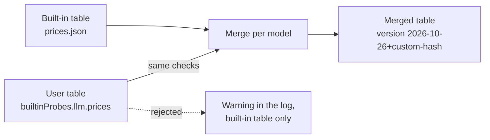

# HoneybeePF Grafana Dashboards

Pre-built Grafana dashboards for visualizing metrics exported by the
HoneybeePF eBPF agent via OpenTelemetry → Prometheus.

## Dashboards

| File | Title | Panels | Focus |
|------|-------|:------:|-------|
| [`honeybeepf-cost.json`](./honeybeepf-cost.json) | HoneybeePF — LLM Cost Observability | 15 | LLM API traffic, token usage, latency, cost attribution by team / pod / model |
| [`honeybeepf-security.json`](./honeybeepf-security.json) | HoneybeePF — Security & Compliance | 11 | File access monitoring, LLM ↔ file-access correlation, per-process auditing |

### Cost Observability (`honeybeepf-cost.json`)

Two sections — **External LLM API** and **On-Premise LLM** — with:

- Requests / minute (by team, by model)
- Token usage / minute (prompt vs completion, by team, by model)
- Token share pie chart
- Latency p50 / p95 / p99
- 5-minute summary stats (total requests, total tokens, active probes)
- Per-pod token usage and p95 latency
- Top 10 pods by token usage

Template variables: `$datasource`, `$team`, `$pod`, `$model`.

### Security & Compliance (`honeybeepf-security.json`)

Three sections:

- **File Access Overview** — events / minute, by namespace, top 10 accessed files
- **Correlation & Hot Paths** — LLM ↔ file-access correlation, file access by path
- **Summary (Last 5 Minutes)** — total events, unique files accessed, active probes

Template variables: `$datasource`, `$process`.

## Required Metrics

These dashboards expect the following Prometheus metrics exported by the
HoneybeePF agent. The agent emits them via OTLP to an OpenTelemetry
Collector, which forwards them to Prometheus.

### LLM metrics

| Metric | Type | Labels |
|--------|------|--------|
| `honeybeepf_llm_llm_requests_total` | Counter | `model`, `status`, `target_namespace`, `target_pod_name` |
| `honeybeepf_llm_llm_tokens_total` | Counter | `model`, `status`, `token_type` (prompt / completion), `target_namespace`, `target_pod_name` |
| `honeybeepf_llm_llm_cache_read_tokens_total` | Counter | `model`, `status`, `target_namespace`, `target_pod_name` (subset of prompt tokens) |
| `honeybeepf_llm_llm_cache_write_tokens_total` | Counter | `model`, `status`, `target_namespace`, `target_pod_name` (subset of prompt tokens) |
| `honeybeepf_llm_llm_reasoning_tokens_total` | Counter | `model`, `status`, `target_namespace`, `target_pod_name` (subset of completion tokens) |
| `honeybeepf_llm_llm_cost_usd_total` | Counter (USD) | `model`, `status`, `cost_type` (input / cache_read / cache_write / output), `price_table_version`, `target_namespace`, `target_pod_name` |
| `honeybeepf_llm_llm_unpriced_tokens_total` | Counter | `model`, `status`, `reason` (unknown_model / missing_price / unsupported_modifier / inconsistent_usage), `price_table_version`, `target_namespace`, `target_pod_name` |
| `honeybeepf_llm_llm_latency_seconds_bucket` | Histogram | `model`, `status`, `target_namespace`, `target_pod_name` |

Every LLM metric that has `target_pod_name` also has `target_workload_kind` and `target_workload_name`: the pod's owner, with a ReplicaSet resolved to its Deployment or Argo Rollout and a Job to its CronJob (`Pod` and the pod name for a pod without an owner, `unattributed` when the owner cannot be named). The workload is fixed by the pod, so these labels add no series (except a Job pod relabelled with its CronJob after a failed lookup). The cost dashboard groups the On-Premise panels by namespace and workload; the **Workload** and **Pod** variables drill down.

Cost comes from the built-in price table (`honeybeepf-llm-core/src/prices.json`; every provider entry names its pricing page and the date it was checked). A call the table cannot price is counted in `llm_unpriced_tokens_total`, never as $0, so compare the two before trusting a total. Prices are the providers' first-party list prices: the price is chosen by model name, not by host, so Azure OpenAI, Bedrock, Vertex AI and regional endpoints (such as OpenAI data residency, +10%) are priced as the first-party API. Per-request tool fees (web search) and audio input prices are not included.

To use negotiated or self-hosted prices, set `builtinProbes.llm.prices` in the chart (or point `LLM_PRICES_CONFIG_FILE` at a file) to a table in the same format. Each model listed there replaces the whole built-in entry (list its tiers, speed and geo prices too) or adds a new one. A provider's `price_multiplier` multiplies its prices: `0.8` means you pay 80% of the list price (a 20% discount). It applies to every built-in price of that provider, not to the models the file lists. A provider with only a multiplier still needs `source`, `checked` and `models: {}`. The file goes through the same checks as the built-in table; if it is rejected, the agent logs a warning and keeps the built-in prices. With a user table loaded, `price_table_version` reads `<built-in version>+custom-<hash of the file>`, and the startup log lists the replaced and added models. Prices are read at startup, so run `kubectl rollout restart ds/honeybeepf-llm` after changing them.

#### Example



```yaml
builtinProbes:
  llm:
    prices:
      version: "acme-2026-10"
      providers:
        - name: "openai"
          source: "our contract"
          checked: "2026-10-01"
          price_multiplier: 0.8
          models:
            gpt-5: {input: 1.0, output: 8.0, cache_read: 0.1}
        - name: "vllm"
          source: "internal"
          checked: "2026-10-01"
          models:
            my-vllm-llama: {input: 0.1, output: 0.2}
```

With the built-in table `2026-10-26`, this gives (USD per million tokens, input / output / cache read):

| Model | Built-in price | Merged price | Why |
|---|---|---|---|
| `gpt-4o` | 2.50 / 10.00 / 1.25 | 2.00 / 8.00 / 1.00 | × 0.8 |
| `gpt-5-mini` | 0.25 / 2.00 / 0.025 | 0.20 / 1.60 / 0.02 | × 0.8 (flex and priority tiers too) |
| `gpt-5` | 1.25 / 10.00 / 0.125 | 1.00 / 8.00 / 0.10 | Set in the file; no multiplier, and no flex or priority price unless listed |
| `my-vllm-llama` | none (`unknown_model`) | 0.10 / 0.20 / none | Added |
| `claude-sonnet-4-5` | 3.00 / 15.00 / 0.30 | 3.00 / 15.00 / 0.30 | Other provider, unchanged |

To check it, look for `Custom prices: replaced [gpt-5], added [my-vllm-llama]` in the agent log, and for `price_table_version="2026-10-26+custom-<hash>"` on `honeybeepf_llm_llm_cost_usd_total`. Unknown models should drop out under the new version:

```promql
sum by (model, price_table_version) (increase(honeybeepf_llm_llm_unpriced_tokens_total{reason="unknown_model"}[1h]))
```

### Security / file-access metrics

| Metric | Type | Labels |
|--------|------|--------|
| `honeybeepf_llm_file_access_events_total` | Counter | `filename`, `flags`, `process`, `cgroup_id`, `target_namespace`, `target_pod_name` |

### Agent metrics

| Metric | Type | Labels |
|--------|------|--------|
| `honeybeepf_llm_active_probes` | Gauge | `probe` |

> **Note:** `target_namespace` and `target_pod_name` labels are only populated
> when the agent is built with the `k8s` feature flag (the Docker image uses
> this by default).

## Installation

### Option 1 — Import via Grafana UI (simplest)

1. Open Grafana → **Dashboards → New → Import**
2. Click **Upload JSON file** and select one of the files in this directory
3. When prompted, choose your Prometheus data source (the dashboards default
   to a data source named `Prometheus`)
4. Click **Import**

Repeat for both dashboards.

### Option 2 — ConfigMap + Grafana sidecar (Kubernetes)

If your Grafana is configured with the
[`grafana-sidecar-dashboards`](https://github.com/kiwigrid/k8s-sidecar)
pattern (as in the official Grafana Helm chart with
`sidecar.dashboards.enabled=true`), create a labeled ConfigMap and the
sidecar will pick up the dashboards automatically:

```bash
kubectl -n monitoring create configmap honeybeepf-dashboards \
  --from-file=docs/grafana/honeybeepf-cost.json \
  --from-file=docs/grafana/honeybeepf-security.json

kubectl -n monitoring label configmap honeybeepf-dashboards \
  grafana_dashboard=1
```

Within a minute the sidecar will discover the ConfigMap, and both dashboards
will appear in Grafana.

### Option 3 — Helm values (for the HoneybeePF chart)

See [`charts/honeybeepf-llm/values.yaml`](../../charts/honeybeepf-llm/values.yaml)
for the Helm-based deployment. Dashboards can be shipped alongside the chart
by rendering a ConfigMap from these JSON files.

## Data Source Configuration

Both dashboards use a `$datasource` template variable so they work with any
Prometheus-compatible backend:

- Prometheus
- Thanos
- Mimir
- VictoriaMetrics
- Cortex

The default data source name is `Prometheus`. If your data source has a
different name, select it from the **Datasource** dropdown at the top of
the dashboard after import.

Rate panels use `$__rate_interval` with a 1m **Min step**, which matches the
1m scrape interval of `charts/honeybeepf-llm-prometheus`. Without that step,
and with no Scrape interval set on the data source, Grafana assumes 15s, the
window shrinks to 1m and holds fewer than two samples, and the panels show
No data. The step overrides the data source's Scrape interval, so if your
Prometheus scrapes less often than 1m, raise it to match; if more often, you
can lower it.

## Updating the dashboards

If you modify a dashboard inside Grafana and want to save the changes back:

1. Open the dashboard
2. Click the **Share** icon → **Export** tab
3. Enable **Export for sharing externally**
4. Click **Save to file** and overwrite the corresponding JSON here
5. Run a quick sanity check:

```bash
jq -e . docs/grafana/honeybeepf-cost.json > /dev/null && echo ok
grep -c VictoriaMetrics docs/grafana/*.json   # should be 0 for both
```

> **Important:** Before committing an updated JSON, make sure every
> `"uid": "..."` under any `"datasource"` field is set to `"${datasource}"`
> — not a hardcoded data source name. Hardcoded UIDs make the dashboard
> unusable on anyone else's Grafana instance.

## License

These dashboards are distributed under the [Apache License 2.0](../../LICENSE),
the same license as the rest of the HoneybeePF project.
