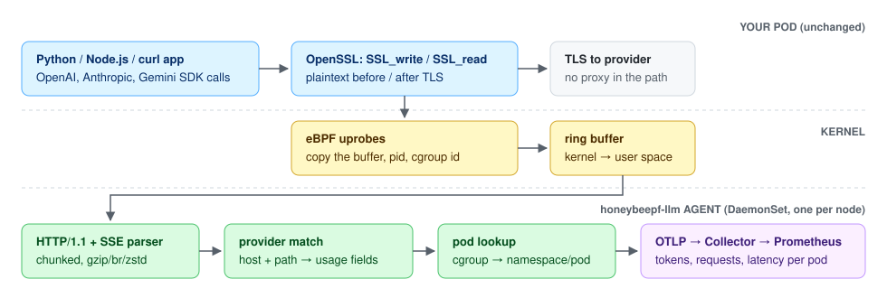

<!-- translated from docs/how-it-works.md at 250d516 -->

# Como funciona { #how-it-works }

!!! note ""
    Esta página é uma tradução do original em inglês. Se houver diferença, vale o [original em inglês](https://honeybee-studio.github.io/honeybeepf-llm/how-it-works/).

Uma aplicação que chama um provedor de LLM entrega a requisição em texto em claro à sua biblioteca TLS e recebe dela a
resposta também em claro. O honeybeepf-llm lê uma cópia desses bytes nesse ponto, no nó, com eBPF. A
aplicação, o SDK dela e o caminho de rede até o provedor continuam como estão.

## 1. Encontrar o código TLS { #1-find-the-tls-code }

O agente roda como um DaemonSet, um Pod por nó. Ele examina todos os processos do seu nó e descobre onde cada um faz
TLS:

| O processo | O agente se anexa a |
|---|---|
| mapeia uma `libssl.so` compartilhada (Python, Node.js de pacotes da distribuição, curl) | `SSL_read`, `SSL_write` e suas variantes `_ex` nessa biblioteca |
| tem o OpenSSL embutido no executável (os binários oficiais do Node.js) | as mesmas funções no executável |
| é um executável Go 1.20+ | `crypto/tls` `(*Conn).Write`, `Read` e cada retorno de `Read`, encontrados pela tabela de funções do Go, inclusive em binários sem símbolos |

Ele também se anexa a processos que iniciam depois: uma probe em `exec` e na abertura de um arquivo `libssl` o avisa
sobre os novos. Programas que usam outra pilha TLS, como rustls ou o JSSE do Java, ainda ficam de fora; a
[métrica de cobertura](guides/coverage.md) lista esses programas.

## 2. Copiar o texto em claro { #2-copy-the-plaintext }

Cada probe é um programa eBPF que roda quando a função é chamada ou retorna. Ele copia o buffer de texto em claro (até
16 KB de uma leitura e 4 KB de uma escrita), o id do processo e o id do cgroup para um ring buffer compartilhado com o
agente. Os programas só leem: nenhum deles altera a chamada, os dados ou a conexão.

Um servidor de modelos dentro do cluster chamado via HTTP simples, como Ollama ou vLLM, não tem biblioteca TLS para
instrumentar. Para um provedor que você marca com `plaintext`, o agente copia os bytes diretamente no socket (veja
[Modelos auto-hospedados via HTTP simples](guides/plaintext.md)).

## 3. Transformar bytes em chamadas { #3-turn-bytes-into-calls }

No espaço de usuário, o agente remonta os bytes de cada conexão em requisições e respostas HTTP/1.1 ou HTTP/2, ou em
mensagens WebSocket (Realtime, Responses, Gemini Live),
os descomprime (`gzip`, `br`, `zstd`, `deflate`) e acompanha os fluxos de server-sent events até o fim. Ele identifica
o provedor pelo host e pelo caminho da requisição e lê as contagens de tokens nos campos de uso da resposta: prompt,
completion, leitura e escrita de cache e tokens de raciocínio.

Uma chamada que o agente viu, mas não conseguiu ler, não é descartada em silêncio: ela é contada em
`llm_responses_unparsed_total` com o motivo.

## 4. Encontrar o Pod { #4-find-the-pod }

O cgroup do processo fornece o ID do contêiner. Um watch nos Pods deste nó associa o contêiner ao seu namespace, Pod e
carga de trabalho proprietária, como um Deployment ou um CronJob.

## 5. Precificar a chamada { #5-price-the-call }

O nome do modelo na resposta é procurado em uma tabela de preços embutida e datada, com seus próprios preços ou
descontos por cima. O custo da chamada é dividido do jeito que os provedores cobram: entrada, leitura de cache, escrita
de cache e saída. Um modelo sem preço é contado em `llm_unpriced_tokens_total`, nunca registrado como $0.

## 6. Exportar { #6-export }

O agente exporta tokens, requisições, latência e custo como métricas OpenTelemetry via OTLP, com rótulos de namespace,
Pod, carga de trabalho e modelo, e registra no log uma linha por chamada com o modelo, o Pod, a latência e as contagens
de tokens (o caminho da requisição no nível `debug`). Os bytes capturados ficam na memória do agente e são descartados
depois de interpretados: prompts, respostas, cabeçalhos e chaves de API nunca são exportados nem vão para o log.

A [revisão de segurança](security-review.md) lista cada programa eBPF, os privilégios de que o agente precisa e o que
ele consegue e não consegue ver.
