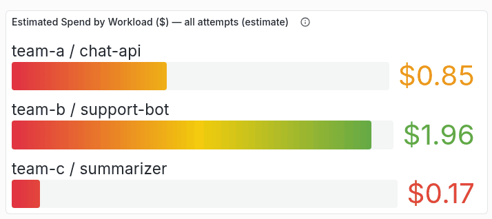

<!-- translated from docs/index.md at 250d516 -->

<div class="hb-hero" markdown>

<div class="hb-hero__text" markdown>

<h1>Su factura de LLM, <em>repartida por equipo.</em></h1>

<p class="hb-sub">Su proveedor envía un único total. honeybeepf-llm muestra qué espacio de nombres, Pod y modelo lo
gastaron, sin tocar sus aplicaciones.</p>

[Inicio rápido :material-arrow-right:](quickstart.md){ .md-button .md-button--primary }
[GitHub :fontawesome-brands-github:](https://github.com/honeybee-studio/honeybeepf-llm){ .md-button }

<p class="hb-meta">Código abierto, Apache-2.0 · DaemonSet de eBPF para Kubernetes · Métricas de OpenTelemetry</p>

</div>

<div class="hb-receipt-wrap">
<div class="hb-receipt" data-hb-live role="img" aria-label="Un recibo que imprime las llamadas al LLM a medida que ocurren en el clúster de demostración, con un subtotal por equipo: team-b $1.96, team-a $0.85, team-c $0.17, total $2.98">
  <div class="hb-receipt__head">
    <strong>honeybeepf-llm</strong>
    <span>clúster demo · nodo worker-1</span>
    <span class="hb-receipt__live"><i></i>imprimiendo en vivo</span>
  </div>
  <ol class="hb-receipt__items" data-hb-log>
    <li><b>team-b/support-bot</b><span>claude-sonnet-4-5 × 1,840 tok</span><em>$0.011</em></li>
    <li><b>team-a/chat-api</b><span>gpt-5.4-mini × 2,310 tok</span><em>$0.002</em></li>
    <li><b>team-c/summarizer</b><span>gemini-2.5-flash × 3,020 tok</span><em>$0.001</em></li>
    <li><b>team-b/support-bot</b><span>claude-opus-5-5 × 960 tok</span><em>$0.019</em></li>
  </ol>
  <div class="hb-receipt__subs">
    <div data-hb-team="team-b" data-hb-usd="1.96"><span>team-b</span><i></i><span class="hb-amount">$1.96</span></div>
    <div data-hb-team="team-a" data-hb-usd="0.85"><span>team-a</span><i></i><span class="hb-amount">$0.85</span></div>
    <div data-hb-team="team-c" data-hb-usd="0.17"><span>team-c</span><i></i><span class="hb-amount">$0.17</span></div>
  </div>
  <div class="hb-receipt__total"><span>Total</span><span data-hb-total>$2.98</span></div>
  <div class="hb-receipt__foot">Código de la aplicación modificado: 0 líneas<br>Llamadas simuladas en las cargas de trabajo de demostración</div>
</div>
</div>

</div>

## Cómo se obtiene { #how-you-get-it }

<div class="hb-steps" markdown>

<div class="hb-step" markdown>
<div class="hb-step__art hb-step__art--code">$ helm install honeybeepf-llm \
    oci://ghcr.io/honeybee-studio/\
    charts/honeybeepf-llm

<span>DaemonSet listo: 1 agente por nodo</span></div>
<div class="hb-step__n">1</div>
<h3>Instale un único DaemonSet</h3>

Un agente por nodo. Sus aplicaciones, SDK y claves de API siguen igual.
</div>

<div class="hb-step" markdown>
<div class="hb-step__art hb-step__art--log"><span>pod</span>    team-b/support-bot
<span>host</span>   api.anthropic.com
<span>model</span>  claude-sonnet-4-5
<span>tokens</span> 1,840  <b>$0.011</b></div>
<div class="hb-step__n">2</div>
<h3>Lee cada llamada al LLM</h3>

El agente lee cada llamada en el kernel, justo donde la aplicación la entrega a TLS, y la asocia a su Pod.
</div>

<div class="hb-step" markdown>
<div class="hb-step__art hb-step__art--shot"></div>
<div class="hb-step__n">3</div>
<h3>Vea el costo por equipo</h3>

Tokens y dólares por espacio de nombres, Pod y modelo en Prometheus, con un [dashboard de Grafana](grafana/README.md) incluido.
</div>

</div>

## Pruébelo { #try-it }

=== "Helm"

    Requiere un clúster de Kubernetes con nodos Linux 5.10+, `kubectl` y Helm 3.

    ```bash
    kubectl create namespace honeybeepf
    helm install honeybeepf-llm oci://ghcr.io/honeybee-studio/charts/honeybeepf-llm -n honeybeepf
    kubectl logs -n honeybeepf ds/honeybeepf-llm -f | grep 'LLM SUCCESS'
    ```

    Para el dashboard de costos de Grafana, instale también el Prometheus y el OpenTelemetry Collector incluidos: consulte [Instalación](install.md).

=== "Demo, sin claves de API"

    Ejecuta un proveedor simulado, clientes de LLM en tres espacios de nombres (uno por equipo) y Grafana en cualquier clúster (kind, k3d, minikube).

    ```bash
    git clone https://github.com/honeybee-studio/honeybeepf-llm.git && cd honeybeepf-llm
    examples/demo/demo.sh up
    kubectl -n monitoring port-forward svc/grafana 3000:80
    ```

    Después abra <http://localhost:3000> y vaya al dashboard "LLM Cost Observability".

## ¿Por qué no un gateway o un SDK? { #why-not-a-gateway-or-an-sdk }

<div class="hb-compare" markdown>

| | Gateway / proxy | Instrumentación con SDK | honeybeepf-llm (eBPF) |
|---|---|---|---|
| Cambio en la aplicación | nueva URL base | añadir código, volver a desplegar | ninguno |
| En la ruta de la petición | sí | dentro del proceso | no: lee copias de los búferes |
| Llamadas que ve | solo las que pasan por él | solo el código instrumentado | todos los Pods del nodo |
| Claves de API | pasan por él | en el proceso de la aplicación | nunca se registran (solo ruta, modelo y tokens) |

</div>

## Cómo funciona { #how-it-works }


1. El agente conecta uprobes a `SSL_write` y `SSL_read` en cada `libssl` que mapea un proceso, y a `crypto/tls` en
   los ejecutables de Go.
2. Las uprobes copian el búfer de texto plano, el pid y el id del cgroup a un búfer circular de BPF.
3. En el espacio de usuario, el analizador de HTTP/1.1, HTTP/2 y SSE reensambla cada llamada, determina el proveedor a partir
   del host y la ruta, y lee los campos de uso de la respuesta.
4. El cgroup asocia el proceso a su Pod, y el resultado se exporta como métricas de OpenTelemetry.

## Para seguir leyendo { #read-next }

<div class="hb-index" markdown>

- [Inicio rápido](quickstart.md): instale el agente y vea las llamadas en pocos minutos.
- [Cómo funciona](how-it-works.md): de un búfer TLS a dólares por Pod, paso a paso.
- [Qué se admite](providers.md): proveedores, entornos de ejecución, protocolos y kernels.
- [Encontrar las cargas de trabajo que no se ven](guides/coverage.md): una sola consulta las enumera.
- [Añadir un proveedor](guides/custom-providers.md) o [sus propios precios](guides/prices.md).
- [Métricas](metrics.md): cada métrica y etiqueta, y por qué no se registró una llamada.
- [Presupuestos y alertas](alerts.md): reglas de gasto y de calidad de datos incluidas en el chart.
- [Solución de problemas](troubleshooting.md) y [preguntas frecuentes](faq.md).
- [Revisión de seguridad](security-review.md): hooks del kernel, privilegios, tratamiento de datos y limitaciones conocidas.
- [Benchmark de sobrecarga](benchmark.md): CPU, memoria y rendimiento con y sin el agente.

</div>

!!! note ""
    Esta página es una traducción del original en inglés. Si difieren, el [original en inglés](https://honeybee-studio.github.io/honeybeepf-llm/) es el correcto.
