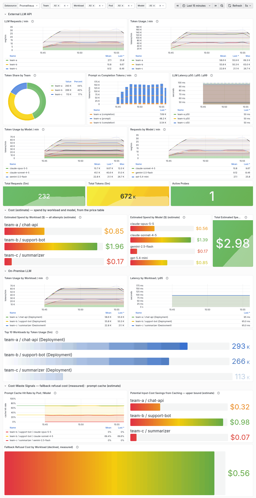

# honeybeepf-llm

**See what every Kubernetes team spends on LLMs: tokens and estimated USD per namespace, pod and model, straight from
eBPF. No code changes, no proxy, no SDK.**

honeybeepf-llm is a Rust eBPF agent that runs as a DaemonSet. It attaches uprobes to OpenSSL's `SSL_write` and
`SSL_read` and to Go's `crypto/tls`, reads the plaintext HTTP of calls to LLM providers, and exports token usage,
request counts, latency and estimated cost per Kubernetes namespace and pod over OpenTelemetry.

## Get started

- [Install](install.md) the agent with Helm, and optionally the bundled Prometheus, OpenTelemetry Collector and
  Grafana dashboards.
- No LLM traffic in the cluster yet? The
  [demo](https://github.com/honeybee-studio/honeybeepf-llm/tree/main/examples/demo) runs a mock provider, clients in
  three team namespaces and Grafana, with no API keys.
- Check [what is supported](providers.md): providers, runtimes, protocols and kernels, and how to list the workloads
  in your cluster whose calls are not seen.

## How it compares

| | Gateway / proxy | SDK instrumentation | honeybeepf-llm (eBPF) |
|---|---|---|---|
| App change | new base URL | add code, redeploy | none |
| In the request path | yes | in-process | no: reads buffer copies |
| Calls it sees | only those routed through it | only instrumented code | every pod on the node |
| API keys | pass through it | in the app process | never logged (path, model, tokens only) |

## How it works

1. The agent finds every `libssl` mapped by a process (and executables with OpenSSL built in) and attaches uprobes to
   `SSL_write` and `SSL_read`, including libraries opened after it started. In Go executables it probes `crypto/tls`
   instead.
2. The uprobes copy the plaintext buffer, the pid and the cgroup id into a BPF ring buffer.
3. In user space, the HTTP/1.1, HTTP/2 and SSE parser reassembles each request and response per connection, picks the
   provider from the host and path, and reads the usage fields from the response.
4. The process's cgroup gives its container ID, which a watch on this node's pods maps to a namespace and pod. The
   result is exported as OpenTelemetry metrics over OTLP.

## Reference

- [Metrics](metrics.md): every metric and label, unparsed reasons, TLS coverage and example PromQL.
- [Alerts](alerts.md): spend, data-quality and agent-health rules shipped with the chart.
- [Grafana dashboards](grafana/README.md): the cost and security dashboards and how to install them.
- [Overhead benchmark](benchmark.md): CPU, memory and throughput with and without the agent.
- [Security review](security-review.md): kernel hooks, privileges, data handling and known gaps.
